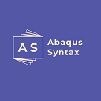

<div align="center">



# Abaqus Syntax Highlighting for VS Code

[](https://marketplace.visualstudio.com/items?itemName=MartinHviid.abaqus-syntax-highlighting)
[](https://marketplace.visualstudio.com/items?itemName=MartinHviid.abaqus-syntax-highlighting)
[](https://marketplace.visualstudio.com/items?itemName=MartinHviid.abaqus-syntax-highlighting)
[](LICENSE)

An unofficial VS Code extension that makes Abaqus input files easier to read and work with: syntax highlighting, code folding, hover information, and a set of commands for cleaning up model files.


</div>

---

## Contents

- [Features](#features)
- [Requirements](#requirements)
- [Installation](#installation)
- [Usage](#usage)
  - [Commands](#commands)
  - [Code folding](#code-folding)
  - [Custom hover information](#custom-hover-information)
- [Extension settings](#extension-settings)
- [Notes and limitations](#notes-and-limitations)
- [Release notes](#release-notes)
- [License](#license)

---

## Features

- **Syntax highlighting** for keyword lines (`*STEP`, `*BOUNDARY`, …), parameters and bare flags, numbers (including `D` exponents), quoted and unquoted labels, `<parametric>` placeholders, and `**` comments. Data lines of `*PARAMETER` blocks are highlighted as Python.
- **Code folding** derived from the file's keyword structure — works out of the box, no command or setting needed (see [Code folding](#code-folding)).
- **Custom hover information** — hover any word to see your own markdown notes, loaded from a JSON file (see [Custom hover information](#custom-hover-information)).
- **Editor commands** for the doc-wrangling Abaqus models tend to need: indenting, compacting, formatting, and stripping comments or blank lines (see [Commands](#commands)).

Supported file extensions:

| Extension | Typical use |
| --------- | ----------- |
| `.inp`    | Abaqus input files |
| `.inc`    | Include files |
| `.incl`   | Include files |
| `.pes`    | Abaqus input files |

---

## Requirements

- Visual Studio Code **1.61.0** or newer. No other dependencies.

---

## Installation

**From the Marketplace (recommended):**

1. Open the Extensions view (`Ctrl+Shift+X`).
2. Search for **Abaqus Syntax Highlighting**.
3. Click **Install**.

Or install directly from [the Marketplace page](https://marketplace.visualstudio.com/items?itemName=MartinHviid.abaqus-syntax-highlighting).

**From the command line:**

```bash
code --install-extension MartinHviid.abaqus-syntax-highlighting
```

---

## Usage

### Commands

Open the command palette with `Ctrl+Shift+P` and type **Abaqus** to see all commands. Every command operates on the **entire file** and counts as a single undo step.

| Command | Description |
| ------- | ----------- |
| `Abaqus: Indent lines` | Indents data lines by two spaces. Keyword lines (lines starting with `*`) and already-indented lines are left unchanged. |
| `Abaqus: Remove leading spaces` | Strips leading whitespace from data lines. Keyword lines are left unchanged. |
| `Abaqus: Format` | Normalizes spacing after commas, e.g. `ELSET,ELEMENT` becomes `ELSET, ELEMENT`. |
| `Abaqus: Compact` | Strips leading whitespace and removes spaces after commas. |
| `Abaqus: Remove all comments` | Deletes every comment line (lines starting with `**`). |
| `Abaqus: Remove empty comments` | Deletes comment lines containing only `**`, plus blank lines. |
| `Abaqus: Remove blank lines` | Deletes all blank lines. |
| `Abaqus: Uppercase` | Converts the entire file to uppercase. |

### Code folding

Folding is built in and driven by the file's keyword structure — no command or setting needed:

- **Wrapper keywords** (`*STEP`, `*PART`, `*ASSEMBLY`, `*INSTANCE`, `*LOAD CASE`) fold up to and including their matching `*END` line.
- **Container keywords** such as `*MATERIAL` or `*SURFACE INTERACTION` fold over their contents.
- **Every other keyword** folds over its data lines.

Folds nest, and comments inside a folded span fold with it. If you prefer the old indentation-based behavior, set `"editor.foldingStrategy": "indentation"` in your settings, or disable folding entirely with `"editor.folding": false`.

### Custom hover information

Hover any word in an input file to see hover information. You provide the content yourself as a JSON file where **keys are lowercase words** and **values are markdown strings**:

```json
{
  "default": "# Default hover info \n\n This is a **default** hover 🧐",
  "example": "# Example hover info \n\n This is an **example** 🧐"
}
```


There are two ways to point the extension at your JSON file:

**Alternative 1 — Settings UI.** Open `File > Preferences > Settings`, search for *Abaqus*, and paste the path into **Abaqus Syntax Highlighting: Custom Hover Path Json**.


**Alternative 2 — settings.json.** Run `Preferences: Open User Settings (JSON)` from the command palette and add:

```json
{
  "abaqusSyntaxHighlighting.customHover.pathJSON": "C:\\Users\\Username\\Desktop\\customhover.json"
}
```

After changing the path (or the JSON file itself), reload VS Code — hover information is loaded once when the extension activates.

---

## Extension settings

| Setting | Type | Default | Description |
| ------- | ---- | ------- | ----------- |
| `abaqusSyntaxHighlighting.customHover.pathJSON` | `string` | `""` | Path to a `.json` file containing custom hover information. Keys should be all lowercase; values are markdown strings. Takes effect after a window reload. |

---

## Notes and limitations

- Hover information is read **once at activation**. After editing your JSON file or changing the setting, run `Developer: Reload Window` (or restart VS Code) to pick up the changes.
- Hover lookups are case-insensitive, but your JSON **keys must be lowercase**.
- If no JSON file is configured (or the path is invalid), hovering shows placeholder text.
- Comment highlighting follows the Abaqus convention: `**` must be the first characters on the line. Indented `**` lines are treated as fold boundaries but are not highlighted as comments.
- The editor commands act on the whole document — they cannot be applied to a selection.

---

## Release notes

See [CHANGELOG.md](CHANGELOG.md). Recent highlights:

- **2.3.0** — Native code folding for Abaqus keyword blocks.
- **2.2.x** — Support for the `.pes` extension; hover regex fix.
- **2.0.0** — Custom hover information.

---

## License

[MIT](LICENSE)

This extension is unofficial and not affiliated with or endorsed by Dassault Systèmes. *Abaqus* is a trademark of Dassault Systèmes or its subsidiaries in the US and/or other countries.
